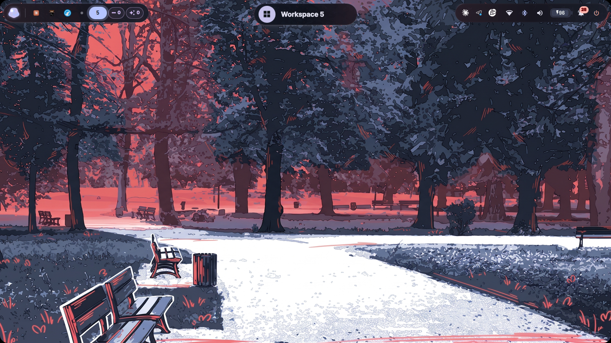
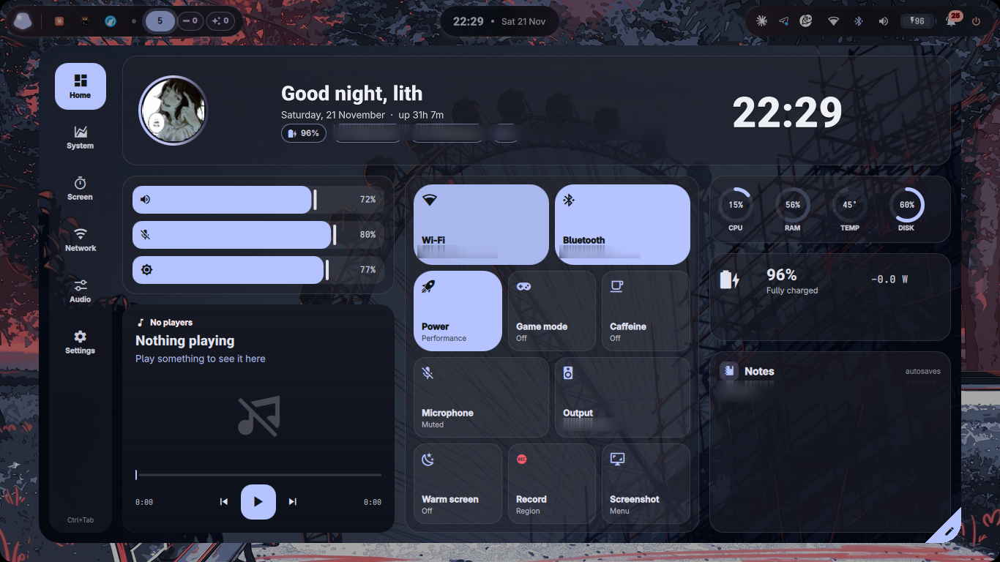
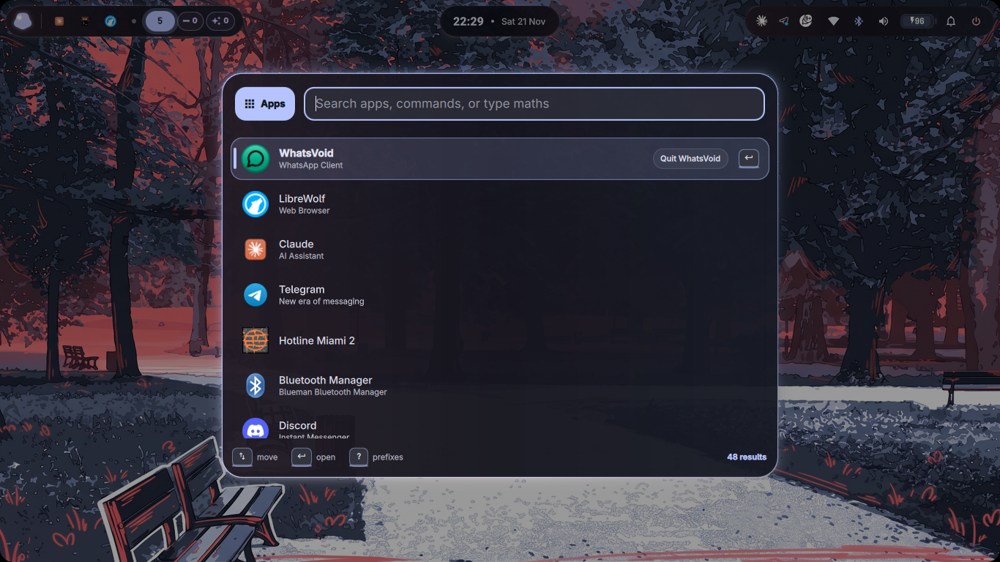
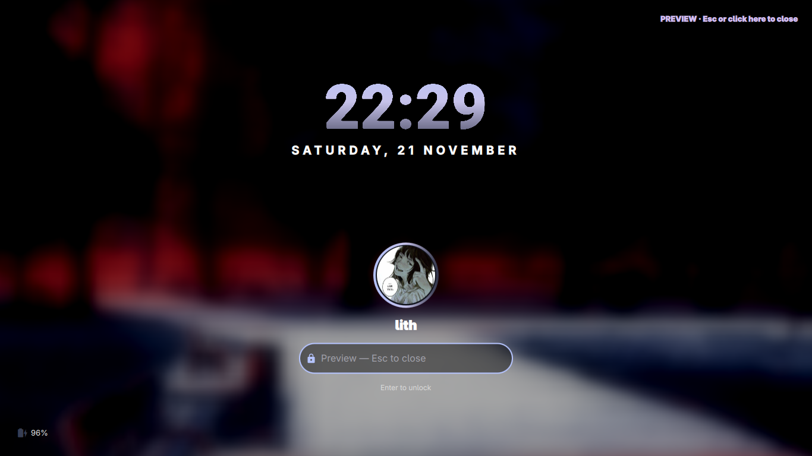
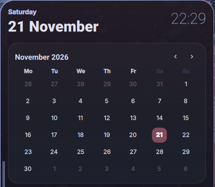

# rice — lith's fork

A Hyprland desktop built on [Quickshell](https://quickshell.org): bar, dashboard, launcher,
notifications, lock screen and colours that follow the wallpaper.
This is lith's branch of [ForeverAlkash/rice](https://github.com/ForeverAlkash/rice),
which is a fork of [Prism](https://github.com/Jack02134x/prism-shell).

Tested on **NixOS with Hyprland 0.57.1 and Quickshell 0.3.2**, on a 1366×768 laptop.

## Screenshots


| | |
|---|---|
|  |  |
| *Desktop* | *Dashboard: sliders, toggles, player, stats, notes* |
|  |  |
| *Launcher (ALT + D)* | *Lock screen* |



*Bell panel: calendar and notifications*

## What's different from upstream

- **ALT** is the main mod key, not SUPER.
- **Removed:** weather (it was hardcoded to one city), the pacman update counter,
  the Ollama AI launcher, easyeffects, the NVIDIA GPU card, 4-finger back/forward swipes
  (the 3-finger workspace swipe is kept).
- **Bar:** 5 workspaces, one clock, and no overlap on small screens.
- **Dashboard:** its own background image, see-through cards, a readable clock.
- **Fixes:** the mute OSD showed the opposite state, `qs ipc call dashboard tab` opened the
  wrong tab, the hot corner did nothing, cancelled recordings said "Recording saved", and a
  cancelled polkit password was kept for the next request.

Full diff against upstream: `git diff upstream/main...lith`

## Requirements

- **Hyprland 0.55 or newer** (the config is written in Lua)
- **Quickshell 0.3**
- matugen, awww, cliphist, wl-clipboard, grim, slurp, wf-recorder, hyprpicker, hyprsunset,
  hyprlock, playerctl, brightnessctl, pactl, jq, imagemagick, ffmpegthumbnailer, python3,
  qt6ct, kitty, nautilus
- Fonts: Roboto, Adwaita Sans, Symbols Nerd Font, JetBrainsMono Nerd Font

## Install

Your current configs are backed up before anything is replaced, but make your own backup too.

### Arch

```sh
git clone -b lith https://github.com/lithxzl04/rice.git rice && cd rice && ./install.sh
```

The script installs the packages with pacman, copies the configs into `~/.config`, points
matugen at your home, creates `config.json` from `config.example.json`, adds the PAM file for
the lock screen, and downloads wallpapers into `~/Pictures/Wallpapers` if that folder is empty.

### NixOS (tested)

Install the packages above, then link the config folders from your clone instead of copying
them. Quickshell writes its own state into its folder, so the link must point to a writable
path, not into the Nix store:

```nix
# inside home-manager.users.<you>
xdg.configFile = lib.genAttrs [ "quickshell" "matugen" "kitty" "cava" "btop" "fastfetch" "qt6ct" ]
  (d: { source = config.lib.file.mkOutOfStoreSymlink "/home/<you>/dotfiles/rice/${d}"; });

# system level
security.pam.services.hyprlock-password = { };
qt = { enable = true; platformTheme = "qt5ct"; };   # puts qt6ct and Qt plugins on the plugin path
environment.pathsToLink = [ "/share/color-schemes" ];
```

### Other distros (untested)

```sh
for d in quickshell matugen kitty cava btop fastfetch qt6ct gtk-3.0 gtk-4.0; do cp -r $d ~/.config/; done
cp hypr/hyprland.lua ~/.config/hypr/
cp quickshell/config.example.json ~/.config/quickshell/config.json
sed -i "s|/home/[^/]*/\.config|$HOME/.config|g" ~/.config/matugen/config.toml
sed -i 's|/run/current-system/sw/share/|/usr/share/|' ~/.config/qt6ct/qt6ct.conf
printf 'auth required pam_unix.so\naccount required pam_unix.so\n' | sudo tee /etc/pam.d/hyprlock-password
```

On Debian, Hyprland 0.55+ and Quickshell are only in trixie-backports, forky and sid,
and matugen and awww are not packaged, so install those two from their upstream projects.

Then log in to Hyprland again. The shell starts at login, not on a config reload.

## Keybinds

The main key is **ALT**. Press **ALT + /** to see every bind.

| Keys | Action |
|---|---|
| ALT + Return | Terminal |
| ALT + D | Launcher (`>` clipboard, `:` emoji, `$` shell, `=` calc, `?` help) |
| ALT + Esc | Dashboard |
| ALT + N | Calendar and notifications |
| ALT + W | Wallpaper picker |
| ALT + C | Clipboard history |
| ALT + L | Lock |
| ALT + M | Power menu |
| Print | Screenshot menu |
| ALT + R | Start / stop recording |
| ALT + 1…5 | Workspaces |

## Configuration

- `~/.config/quickshell/config.json` holds the shell settings (copied from
  `config.example.json`). Change `apps` if you don't use kitty, nautilus and librewolf.
- Wallpapers are read from `~/Pictures/Wallpapers`; set `wallpaper.dir` to use another folder.
- The dashboard background is loaded from `~/Pictures/wallpapers/ferris-wheel.jpg`.
  Put any image there; without one the dashboard has a plain dark background.
- `kitty.conf` includes `~/.config/kitty-colors.conf`, which matugen writes the first time
  you pick a wallpaper.

## Known issues

- Without a `hypr-screentime` tracker, the shell logs a warning every 15 seconds.
- The `a ` launcher prefix needs `ani-cli`.

## Credits and license

Everything here is built on [Prism](https://github.com/Jack02134x/prism-shell) by
[Jack02134x](https://github.com/Jack02134x), and on
[ForeverAlkash/rice](https://github.com/ForeverAlkash/rice). Upstream has no license file,
so ask the authors before reusing their code outside a GitHub fork.
